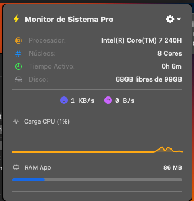
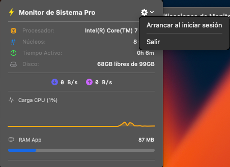
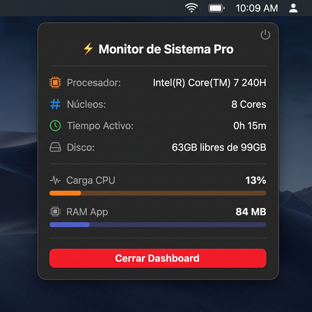

# MonitorPro

[](https://swift.org)
[](https://www.apple.com/macos)
[](https://developer.apple.com/xcode/swiftui/)
[](https://github.com/alberto2005-coder/MonitorPro/actions/workflows/build-app.yml)
[](LICENSE)

[Español](#español) · [English](#english)

> Desarrollado por **[Alberto Ortiz](https://github.com/alberto2005-coder/)** · [albertoortiz.is-a.dev](https://albertoortiz.is-a.dev/)

---

## Español

### Índice

- [Descripción](#descripción)
- [Capturas de pantalla](#capturas-de-pantalla)
- [Características](#características)
- [Requisitos](#requisitos)
- [Instalación](#instalación)
- [Uso](#uso)
- [Notificaciones](#notificaciones)
- [Arquitectura del proyecto](#arquitectura-del-proyecto)
- [Flujo de datos](#flujo-de-datos)
- [Tecnologías utilizadas](#tecnologías-utilizadas)
- [Integración continua](#integración-continua)
- [Pruebas](#pruebas)
- [Limitaciones conocidas](#limitaciones-conocidas)
- [Licencia](#licencia)

### Descripción

**MonitorPro** es una aplicación nativa de **barra de menú para macOS** que muestra el estado del sistema en tiempo real: carga de CPU, historial de CPU, memoria de la app, disco, tiempo activo y velocidad de red.

No abre ventanas flotantes ni ocupa el Dock: el icono vive en la barra superior y muestra el porcentaje de CPU. Al hacer clic se despliega un panel de 320 puntos con todos los datos.

> [!NOTE]
> La interfaz de la aplicación está **solo en español**. Este README está en español e inglés.

### Capturas de pantalla

<div align="center">

**V2 — gráfica de CPU, red y menú dinámico**




**V1 — versión inicial**



</div>

### Características

| Métrica | Qué muestra | Actualización |
|---|---|---|
| **CPU** | Nombre y modelo del procesador (`sysctlbyname`) | Al iniciar |
| **Núcleos** | Número de núcleos activos | Al iniciar |
| **Tiempo activo** | Horas y minutos desde el arranque | Cada segundo |
| **Disco** | GB libres y totales de `/` | Cada segundo |
| **Carga de CPU** | Porcentaje real calculado por diferencial de ticks (user + system + nice frente a idle) | Cada segundo |
| **Historial de CPU** | Gráfica con las últimas 60 muestras, aproximadamente un minuto | Cada segundo |
| **Memoria** | MB residentes que usa **MonitorPro**, no la RAM total del sistema | Cada segundo |
| **Red** | Velocidad de bajada y subida de las interfaces activas, sin loopback | Cada segundo |

Además:

- **Barra de menú** con el porcentaje de CPU en el título y estilo `.window`.
- **Swift Charts** para la gráfica de CPU (línea y área, escala fija de 0 a 100 %).
- **Notificaciones del sistema** cuando la CPU supera el 90 % o queda menos del 10 % de disco libre.
- **Arranque al iniciar sesión** mediante `SMAppService.mainApp`, configurable desde el menú del engranaje.
- **Salir** desde el mismo menú, sin usar el Monitor de Actividad.
- **Sin dependencias externas**: solo frameworks de Apple.

### Requisitos

- **macOS 13 Ventura** o superior (`MenuBarExtra` y `SMAppService`).
- **Xcode 15** o superior.
- **Swift 5.9** o superior.
- Mac con Apple Silicon o Intel.

### Instalación

#### Desde el código fuente

1. **Clona el repositorio:**

   ```bash
   git clone https://github.com/alberto2005-coder/MonitorPro.git
   cd MonitorPro
   ```

2. **Abre el proyecto en Xcode:**

   ```bash
   open MonitorPro.xcodeproj
   ```

3. **Selecciona tu Mac** como destino en la barra de Xcode.

4. **Compila y ejecuta** con `⌘ + R`.

> [!IMPORTANT]
> Para ejecutarlo en tu Mac puede que necesites configurar un **Team de desarrollo** en *Signing & Capabilities* con tu Apple ID. La app tiene el **App Sandbox** activado.

#### Desde la terminal

```bash
xcodebuild -project MonitorPro.xcodeproj \
           -scheme MonitorPro \
           -configuration Release \
           build
```

#### Artefacto de GitHub Actions

Cada push a `main` que no sea solo documentación genera `MonitorPro.app.zip` como artefacto de la ejecución. En las releases publicadas, el ZIP se adjunta automáticamente a la release. El binario va **sin firmar**, así que macOS puede pedir confirmación en *Privacidad y seguridad* la primera vez.

### Uso

1. Al abrir la app aparece un icono con forma de medidor en la barra de menú y el porcentaje de CPU actual.
2. Haz **clic** en el icono para desplegar el panel.
3. El panel muestra, de arriba abajo:
   - Procesador, núcleos, tiempo activo y disco libre/total.
   - Velocidad de bajada y subida.
   - Gráfica de CPU de las últimas 60 muestras y RAM usada por la app.
4. Pulsa el **engranaje** de la esquina superior derecha para:
   - Activar o desactivar **«Arrancar al iniciar sesión»**.
   - **Salir** de la aplicación.

### Notificaciones

MonitorPro pide permiso de notificaciones al arrancar. Después revisa las condiciones cada segundo, pero **como máximo envía una notificación cada 5 minutos** (el enfriamiento es compartido entre ambos avisos):

| Condición | Aviso |
|---|---|
| Carga de CPU **superior al 90 %** | «Alerta de CPU» |
| Espacio libre **inferior al 10 %** del total | «Alerta de Disco» |

Si la CPU está alta y el disco también está bajo, se envía primero el aviso de CPU. Los umbrales están escritos en el código (`SystemMonitor.swift`), no son configurables desde la interfaz.

### Arquitectura del proyecto

```text
MonitorPro/
├── MonitorPro/
│   ├── MonitorProApp.swift      # @main y MenuBarExtra
│   ├── ContentView.swift        # Panel SwiftUI, gráfica y menú
│   ├── MonitorPro.entitlements  # App Sandbox
│   └── Assets.xcassets/         # Iconos y colores
├── SystemMonitor.swift          # ObservableObject con todas las métricas
├── MonitorProTests/             # Tests unitarios (plantilla de Xcode)
├── MonitorProUITests/           # Tests de interfaz (plantilla de Xcode)
├── MonitorPro.xcodeproj/        # Proyecto de Xcode
├── screenshots/                 # Capturas usadas en este README
├── .github/workflows/build-app.yml
├── LICENSE
└── README.md
```

`SystemMonitor.swift` está en la raíz del repositorio, no dentro de `MonitorPro/`; el proyecto de Xcode lo referencia desde ahí.

### Flujo de datos

```text
SystemMonitor (ObservableObject)
├── init()
│   ├── getCPUName()            → processorName
│   ├── permiso de notificaciones
│   └── startMonitoring()
│
├── Timer cada 1 s
│   ├── getMemoryUsage()        → usageMB
│   ├── updateDiskSpace()       → diskFreeGB, diskTotalGB
│   ├── getUptime()             → uptime
│   ├── updateCPULoad()         → cpuLoad, cpuHistory
│   ├── updateNetworkTraffic()  → downloadSpeed, uploadSpeed
│   └── checkAndNotify()        → notificación si procede
│
├── deinit → timer.invalidate()
│
└── @Published → ContentView (SwiftUI) → interfaz
```

La carga de CPU se calcula con `host_processor_info` y `PROCESSOR_CPU_LOAD_INFO`: se guardan los ticks de la muestra anterior y se comparan con los actuales, de modo que el porcentaje refleja el uso real desde la última lectura y no la media desde el arranque.

### Tecnologías utilizadas

| Tecnología | Uso |
|---|---|
| **SwiftUI** | Interfaz y `MenuBarExtra` |
| **Swift Charts** | Gráfica de historial de CPU |
| **Foundation** | `ProcessInfo`, `FileManager`, `Timer` |
| **UserNotifications** | Avisos de CPU y disco |
| **ServiceManagement** | Arranque al iniciar sesión |
| **mach / sysctl** | CPU, memoria y ticks del procesador |
| **getifaddrs** | Tráfico de red por interfaz |

### Integración continua

`.github/workflows/build-app.yml` se ejecuta en `macos-latest` cuando:

- hay un push a `main` (ignorando cambios solo en Markdown y `screenshots/`);
- se lanza manualmente con `workflow_dispatch`;
- se publica una release.

Compila con `xcodebuild` en configuración Release sin firma (`CODE_SIGN_IDENTITY="-"`, `CODE_SIGNING_REQUIRED=NO`), empaqueta el `.app` con `ditto` y lo sube como artefacto `MonitorPro.app`. En releases, `softprops/action-gh-release` adjunta el ZIP.

### Pruebas

```bash
xcodebuild test -project MonitorPro.xcodeproj -scheme MonitorPro -destination 'platform=macOS'
```

`MonitorProTests` y `MonitorProUITests` son las plantillas de Xcode: comprueban que la app arranca, pero **no** validan los cálculos de CPU, disco, red ni notificaciones. Si amplías el proyecto, extrae la lógica de `SystemMonitor` a funciones puras y añade pruebas con muestras de ticks conocidas.

### Limitaciones conocidas

- **La RAM mostrada es la de la app**, no la del sistema. Para la memoria global haría falta `host_statistics64` con `vm_statistics64`.
- **El historial de CPU son 60 muestras de 1 segundo**: algo menos de un minuto, no una hora.
- **La red suma todas las interfaces activas** y descarta loopback; una VPN o una interfaz virtual también cuenta.
- **Umbrales fijos** al 90 % de CPU y 10 % de disco, sin ajustes en la interfaz.
- **Sin firma ni notarización** en el artefacto de CI: macOS puede bloquearlo al descargarlo.
- **Interfaz solo en español**, aunque el README sea bilingüe.
- **Sin preferencias persistentes**: el estado de arranque al iniciar sesión lo gestiona el sistema, no la app.

### Licencia

Distribuido bajo la **Licencia MIT**. Consulta [LICENSE](LICENSE). © 2026 Alberto Ortiz.

---

## English

### Table of contents

- [Overview](#overview)
- [Screenshots](#screenshots)
- [Features](#features)
- [Requirements](#requirements)
- [Installation](#installation)
- [Usage](#usage)
- [Notifications](#notifications)
- [Project structure](#project-structure)
- [Data flow](#data-flow)
- [Technologies](#technologies)
- [Continuous integration](#continuous-integration)
- [Tests](#tests)
- [Known limitations](#known-limitations)
- [License](#license)

### Overview

**MonitorPro** is a native **macOS menu bar app** that shows the state of your system in real time: CPU load, CPU history, the app's own memory use, disk space, uptime and network throughput.

It opens no floating windows and takes no Dock space: the icon lives in the menu bar and shows the CPU percentage. Clicking it opens a 320-point panel with all the readings.

> [!NOTE]
> The application UI is **Spanish only**. This README is available in Spanish and English.

### Screenshots

<div align="center">

**V2 — CPU chart, network and dynamic menu**


**V1 — initial release**


</div>

### Features

| Metric | What it shows | Refresh |
|---|---|---|
| **CPU** | Processor brand string (`sysctlbyname`) | At launch |
| **Cores** | Number of active cores | At launch |
| **Uptime** | Hours and minutes since boot | Every second |
| **Disk** | Free and total GB of `/` | Every second |
| **CPU load** | Real percentage from tick deltas (user + system + nice versus idle) | Every second |
| **CPU history** | Chart with the last 60 samples, roughly one minute | Every second |
| **Memory** | Resident MB used by **MonitorPro**, not the system's total RAM | Every second |
| **Network** | Download and upload speed across active interfaces, loopback excluded | Every second |

In addition:

- **Menu bar** with the CPU percentage in the title and `.window` style.
- **Swift Charts** for the CPU graph (line and area, fixed 0–100 % scale).
- **System notifications** when CPU exceeds 90 % or free disk drops below 10 %.
- **Launch at login** through `SMAppService.mainApp`, toggled from the gear menu.
- **Quit** from the same menu, without opening Activity Monitor.
- **No third-party dependencies**: Apple frameworks only.

### Requirements

- **macOS 13 Ventura** or later (`MenuBarExtra` and `SMAppService`).
- **Xcode 15** or later.
- **Swift 5.9** or later.
- Apple Silicon or Intel Mac.

### Installation

#### From source

1. **Clone the repository:**

   ```bash
   git clone https://github.com/alberto2005-coder/MonitorPro.git
   cd MonitorPro
   ```

2. **Open the project in Xcode:**

   ```bash
   open MonitorPro.xcodeproj
   ```

3. **Select your Mac** as the destination in Xcode's toolbar.

4. **Build and run** with `⌘ + R`.

> [!IMPORTANT]
> To run it on your Mac you may need to set a **development Team** under *Signing & Capabilities* with your Apple ID. The app has **App Sandbox** enabled.

#### From the terminal

```bash
xcodebuild -project MonitorPro.xcodeproj \
           -scheme MonitorPro \
           -configuration Release \
           build
```

#### GitHub Actions artifact

Every push to `main` that is not documentation-only produces `MonitorPro.app.zip` as a workflow artifact. On published releases the ZIP is attached to the release automatically. The binary is **unsigned**, so macOS may ask you to confirm it under *Privacy & Security* the first time.

### Usage

1. When the app starts, a gauge icon appears in the menu bar with the current CPU percentage.
2. **Click** the icon to open the panel.
3. From top to bottom, the panel shows:
   - Processor, cores, uptime and free/total disk.
   - Download and upload speed.
   - A 60-sample CPU chart and the memory used by the app.
4. Use the **gear** in the top-right corner to:
   - Enable or disable **“Arrancar al iniciar sesión”** (launch at login).
   - **Salir** (quit) the app.

### Notifications

MonitorPro requests notification permission at launch. It then checks the conditions every second but sends **at most one notification every 5 minutes** (the cooldown is shared by both alerts):

| Condition | Alert |
|---|---|
| CPU load **above 90 %** | “Alerta de CPU” |
| Free space **below 10 %** of total | “Alerta de Disco” |

If the CPU is high and disk space is also low, the CPU alert wins. The thresholds are hard-coded in `SystemMonitor.swift`; they are not configurable in the UI.

### Project structure

```text
MonitorPro/
├── MonitorPro/
│   ├── MonitorProApp.swift      # @main and MenuBarExtra
│   ├── ContentView.swift        # SwiftUI panel, chart and menu
│   ├── MonitorPro.entitlements  # App Sandbox
│   └── Assets.xcassets/         # Icons and colours
├── SystemMonitor.swift          # ObservableObject with all metrics
├── MonitorProTests/             # Unit tests (Xcode template)
├── MonitorProUITests/           # UI tests (Xcode template)
├── MonitorPro.xcodeproj/        # Xcode project
├── screenshots/                 # Images used by this README
├── .github/workflows/build-app.yml
├── LICENSE
└── README.md
```

`SystemMonitor.swift` lives at the repository root, not inside `MonitorPro/`; the Xcode project references it from there.

### Data flow

```text
SystemMonitor (ObservableObject)
├── init()
│   ├── getCPUName()            → processorName
│   ├── notification permission
│   └── startMonitoring()
│
├── Timer every 1 s
│   ├── getMemoryUsage()        → usageMB
│   ├── updateDiskSpace()       → diskFreeGB, diskTotalGB
│   ├── getUptime()             → uptime
│   ├── updateCPULoad()         → cpuLoad, cpuHistory
│   ├── updateNetworkTraffic()  → downloadSpeed, uploadSpeed
│   └── checkAndNotify()        → notification when needed
│
├── deinit → timer.invalidate()
│
└── @Published → ContentView (SwiftUI) → UI
```

CPU load comes from `host_processor_info` with `PROCESSOR_CPU_LOAD_INFO`: the previous sample's ticks are kept and compared with the current ones, so the percentage reflects real usage since the last reading instead of an average since boot.

### Technologies

| Technology | Purpose |
|---|---|
| **SwiftUI** | UI and `MenuBarExtra` |
| **Swift Charts** | CPU history chart |
| **Foundation** | `ProcessInfo`, `FileManager`, `Timer` |
| **UserNotifications** | CPU and disk alerts |
| **ServiceManagement** | Launch at login |
| **mach / sysctl** | CPU, memory and processor ticks |
| **getifaddrs** | Per-interface network traffic |

### Continuous integration

`.github/workflows/build-app.yml` runs on `macos-latest` when:

- a push lands on `main` (Markdown-only and `screenshots/` changes are ignored);
- it is started manually with `workflow_dispatch`;
- a release is published.

It builds with `xcodebuild` in Release configuration without signing (`CODE_SIGN_IDENTITY="-"`, `CODE_SIGNING_REQUIRED=NO`), packages the `.app` with `ditto` and uploads it as the `MonitorPro.app` artifact. For releases, `softprops/action-gh-release` attaches the ZIP.

### Tests

```bash
xcodebuild test -project MonitorPro.xcodeproj -scheme MonitorPro -destination 'platform=macOS'
```

`MonitorProTests` and `MonitorProUITests` are Xcode's templates: they check that the app launches but do **not** validate the CPU, disk, network or notification logic. If you extend the project, extract `SystemMonitor` logic into pure functions and add tests with known tick samples.

### Known limitations

- **The memory figure is the app's own**, not the system's. System-wide memory would need `host_statistics64` with `vm_statistics64`.
- **CPU history is 60 one-second samples**: slightly under a minute, not an hour.
- **Network totals sum every active interface** and skip loopback; a VPN or virtual interface is included.
- **Fixed thresholds** at 90 % CPU and 10 % disk, with no UI to change them.
- **The CI artifact is unsigned and not notarised**: macOS may block it after download.
- **Spanish-only UI**, even though this README is bilingual.
- **No persisted preferences**: launch-at-login state is owned by the system, not the app.

### License

Distributed under the **MIT License**. See [LICENSE](LICENSE). © 2026 Alberto Ortiz.
